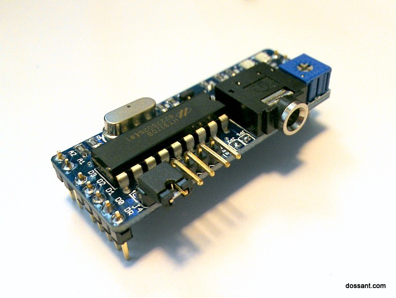

# DTMF Shield for Arduino

A small board that plugs into an Arduino Uno and turns DTMF (touch-tone) signals into digital data the Arduino can read. It was sold by Dossant in 2013-2014 and is **no longer sold**. The design files and docs live here for anyone who owns one, or wants to build their own.

A DTMF decoder chip does the heavy lifting, so the interface to your sketch is a handful of digital pins.

## Features

- Operating voltage 5 V, current draw 3 mA
- Input signal range 27.5 to 869 mVrms (-29 to 1 dBm)
- Trim pot for gain adjustment
- 3.5 mm stereo audio jack (TRS) and standard 0.1" headers
- Easy to reconfigure the audio jack pinout
- LED blinks when a tone is decoded
- Size 20 mm x 55 mm (0.79" x 2.16")
- Decoder: Holtek HT9170B (early boards used the Zarlink MT8870DE; the two are interchangeable)

## Pinout (Arduino Uno)

| Arduino pin | Shield signal | Reference |
|---|---|---|
| 5V | Power in | |
| GND | Ground | |
| 12 | Data ready | DR |
| 11 | Data bit 0 | D0 |
| 10 | Data bit 1 | D1 |
| 9 | Data bit 2 | D2 |
| 8 | Data bit 3 | D3 |
| 7 | Audio out 1 (optional, tone generation) | A1 |
| 6 | Audio out 2 (optional, tone generation) | A2 |

3.3 V, Vin and the second GND are not used.

## Loopback test

The shield generates a DTMF tone, feeds it back into its own audio input and decodes it. If it works, the shield is good.

1. Download this repository and copy the `Tone` folder to `Documents/Arduino/libraries`. It is a modified Tone library that can play two tones at once, one per output pin.
2. Open `dtmf_plug_in_loopback.ino` in the Arduino IDE and upload it to an Arduino Uno.
3. Power down the Arduino and remove anything from the audio jack.
4. Put a jumper between `AIN` and `AOU`.
5. Plug the shield into the Arduino, checking the pin alignment.
6. Power up and open the Serial Monitor. You should see the tones being sent and decoded, and the DATA LED blinks on each decoded tone.

If it does not work, adjust the gain with the blue trim pot and a small screwdriver.

## Gain note

The input stage is an inverting amplifier with gain `G = -R1 / (R2 + R4)`. With the trim pot at minimum the gain is about 2.1, at maximum about 1.0. The decoder only accepts 27.5 to 869 mVrms, so if you inject audio from a phone you may need to raise or lower its volume to land in range.

## Documents

- [User manual v400](docs/DTMF_Module_v400_user_manual.pdf) (PDF, 11 pages)
- [Schematic](docs/dtmf_mod3_schematic.pdf) (PDF)
- [Holtek HT9170 datasheet](https://www.holtek.com/) (search "HT9170")

## Status and history

Sold by Dossant as "DTMF Shield for Arduino", $35, in 2013-2014. Several prototypes preceded the v400 board; the manual and the sketch here document v400.

The original product page was recovered from the [Wayback Machine](https://web.archive.org/web/20140310020938/http://dossant.com/projects/product/dtmf-shield-for-arduino/). The design is provided as is, with no support.

8-3-2013, Igor
